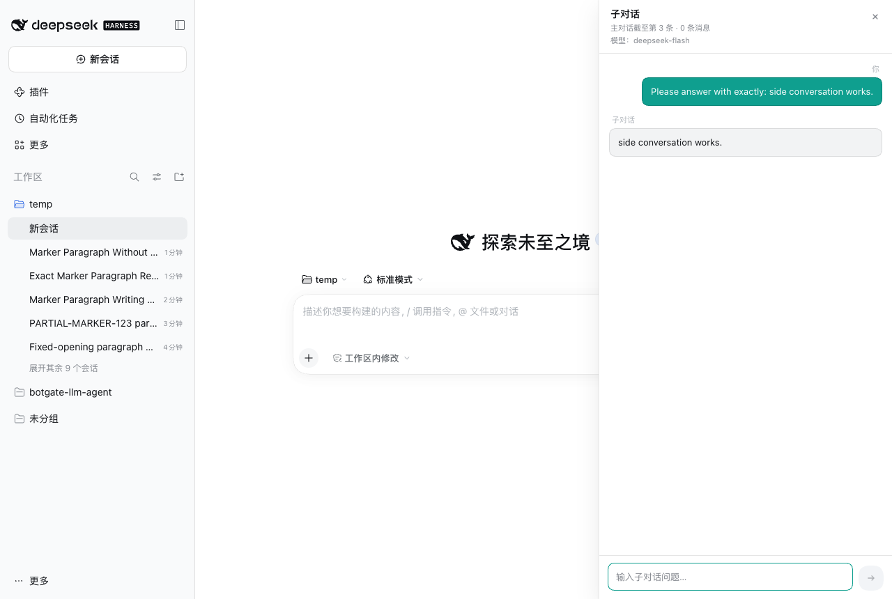
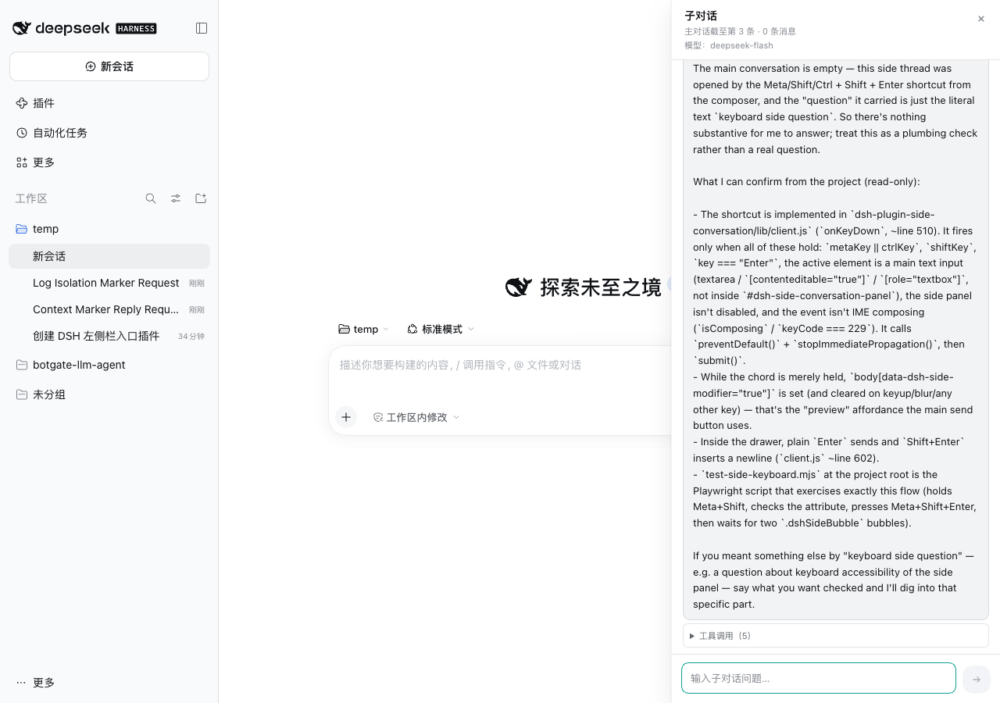
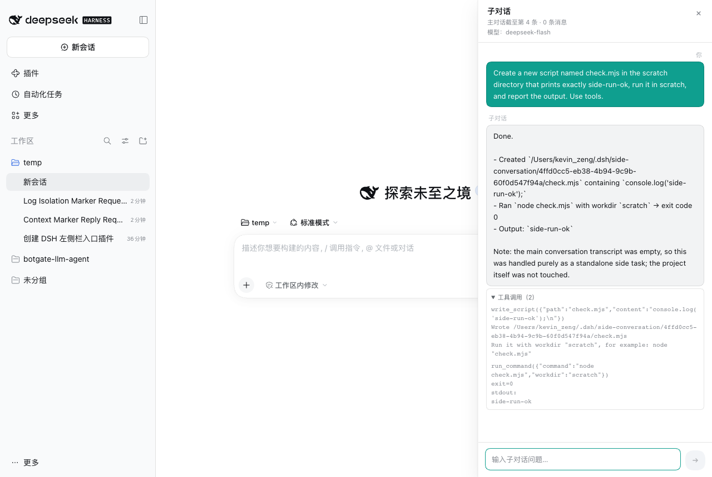

# Side Quest

给 DSH 当前主会话加一个**临时、只读的子对话（Side Conversation）**：不推进主对话、不写入主对话日志；可以基于主对话上下文提问，也可以读取项目、在 scratch 目录写脚本、运行程序和测试。

> 本仓库是可直接安装的 DSH bundle。安装后会通过 `cordis.patch.yml` 自动注册 `side-conversation` 条目，不需要手动改 profile patch。

| 主输入旁的子对话按钮 | 右侧抽屉 |
| --- | --- |
|  |  |

工具调用会显示在回答下方，可展开查看：



## 功能

- 主输入框右侧新增青色圆形子对话按钮（主发送按钮之前）。
- 点击后：
  - 主输入文字移入子对话；
  - 主输入清空；
  - 打开右侧抽屉；
  - 自动发送第一条子对话消息。
- 抽屉内有独立输入框和唯一的青色发送按钮；`Enter` 发送，`Shift+Enter` 换行。
- `Cmd/Ctrl + Shift + Enter` 发送子对话；按住 `Cmd/Ctrl + Shift` 时主发送按钮降到 42% 透明度，松开、失焦或按其他键恢复。
- 只有一个子对话；主会话切换时自动关闭。
- 关闭抽屉立即丢弃历史，不确认、不落盘。
- 子对话默认使用主对话当前模型。
- 子对话消息**不会**追加到主 Session；主对话下一轮请求看不到子对话内容。

## 增量上下文与 KV cache

打开子对话时保存一次主对话快照，之后只追加主对话增量：

```text
第 1 轮: [system][主对话快照 @ seq N][Q1][A1]
第 2 轮: [system][主对话快照 @ seq N][Q1][A1][主对话增量 N+1..M][Q2]
第 3 轮: ... [A2][主对话增量 M+1..K][Q3]
```

- 前缀 `[system][快照][早期问答]` 在后续轮次保持不变，provider 可以复用 KV cache。
- 主对话不回退、不注入；主对话自身仍是 append-only，缓存不受子对话影响。
- 主对话新增的已完成消息通过 `<main_conversation_update>` 追加；正在流式生成的文本只作为本轮临时 `<main_conversation_streaming>`，不写入子对话历史。
- 主对话增量会出现在子对话历史之后，而不是严格保持主对话原始顺序；这是“实时同步 + 缓存稳定”的折中。
- 快照仍然会随每次请求发送，因此仍占用上下文窗口；KV cache 减少的是重复计算/计费，不是把快照从请求里删掉。

## 安装

### 方式 1：直接从 GitHub 安装（推荐）

要求：DSH Desktop / `dsh web` 已安装，且 `dsh` 命令可用。

```sh
dsh plugin --profile desktop add github:zengyongxing/dsh-side-quest
```

- 桌面 App 使用 `desktop` profile；命令行 `dsh web` 使用 `web` profile，按需替换。
- 本仓库的 `package.json` 声明了 `dsh.bundle.patch`，安装时会自动应用 `cordis.patch.yml`。
- 安装完成后**完全退出 DSH（`Cmd+Q`）再打开**。

如果 `dsh` 不在 PATH，可使用桌面 App 自带的 CLI（macOS 示例）：

```sh
"/Applications/DeepSeek Harness.app/Contents/Resources/runtime/cli/bin/dsh" \
  plugin --profile desktop add github:zengyongxing/dsh-side-quest
```

### 方式 2：手动构建 tarball 安装

```sh
git clone https://github.com/zengyongxing/dsh-side-quest.git
cd dsh-side-quest
pnpm pack
dsh plugin --profile desktop add file:./dsh-plugin-side-conversation-0.1.0.tgz
```

### 方式 3：本地开发（link）

```sh
cd ~/.dsh/profiles/desktop
pnpm add link:/absolute/path/to/dsh-side-quest
```

如果使用 `link:` 或不想依赖 bundle 自动注册，手动在
`~/.dsh/profiles/desktop/cordis.patch.yml` 末尾追加：

```yaml
- insert:
    - id: side-conversation
      name: dsh-plugin-side-conversation
```

然后重启 DSH。

### 安装后检查

```sh
ls -la ~/.dsh/profiles/desktop/node_modules/dsh-plugin-side-conversation
```

应该看到一个依赖目录/符号链接。重启后，主输入框右侧会出现青色子对话按钮。

## 使用

1. 在主输入框输入文字。
2. 点击青色子对话按钮，或按 `Cmd/Ctrl + Shift + Enter`。
3. 主输入清空，右侧抽屉打开并自动发送第一条子对话消息。
4. 在抽屉输入框继续提问：
   - `Enter` 发送；
   - `Shift + Enter` 换行；
   - 关闭按钮或 `Esc` 丢弃本次子对话。
5. 主对话可以继续正常输入；子对话不会写入主对话。

## 权限与工具

子对话没有权限选择器，固定为：

| 能力 | 规则 |
| --- | --- |
| 读项目 | `read_file`、`list_dir`，只能读 Session 的 `cwd` 以内 |
| 写项目 | 禁止；没有 `write`/`edit` 工具 |
| 写脚本 | `write_script` 只能写到 `~/.dsh/side-conversation/<threadId>/` |
| 运行程序/测试 | `run_command`（macOS/Linux 使用 `/bin/bash`，Windows 使用 `cmd.exe`；默认 30s，最大 120s） |
| 图片 / `@file` / `/command` | 不支持；主输入包含这些时子对话按钮禁用 |

> `run_command` 可以执行任意 shell 命令，并且会产生真实副作用。系统提示要求“不修改项目源码”，但这不是内核级沙箱。只安装可信来源的版本。

## 测试

```sh
npm test
```

覆盖：

- Host 工具循环、`read_file` 结果注入、关闭后 `thread-not-found`；
- 增量上下文：主对话新增消息后，第二次 `ask` 只出现 `<main_conversation_update>`，不会出现第二份快照；
- Client bundle 解析、两个 Slot 注册、主输入清空、图片/引用/命令禁用。

开发时可用 Playwright/浏览器手动验证：

- 主输入 → 子对话按钮 → 抽屉打开、主输入清空；
- 子对话两轮问答；
- `read_file` / `write_script` / `run_command`；
- `Cmd+Shift+Enter`；
- 关闭抽屉丢弃历史；
- 主 Session 日志大小/mtime 不变。

## 兼容性与限制

- 开发/验证环境：DSH Desktop `0.2.2-rc.1` + Web 客户端 `0.1.0-rc.6` 包。
- 子对话快照仍占用 context window；长主对话需要更大窗口或先压缩主对话。
- 主对话发生 compaction / surface replacement 时，旧快照与增量可能语义不一致，建议关闭重开子对话。
- 流式主对话只纳入 `session.log` 中已出现的文本 chunk；主对话还在 reasoning 或工具调用中间时，只能显示“正在运行，暂无文本”。
- 子对话历史只在内存；关闭、切换主会话、DSH 重启都会丢失。
- 主发送按钮变灰依赖其 `aria-label`（中文“发送消息”/英文“Send message”）；产品改标签时需同步 CSS。
- 本项目是第三方插件，不是 DSH 官方组件；安装前请审查 `lib/index.js` 的 Host 代码。

## 卸载

```sh
# 1. 删除 profile patch 中的 side-conversation 行（如果使用 bundle 自动注册，可跳过）
# 2. 移除依赖
cd ~/.dsh/profiles/desktop && pnpm remove dsh-plugin-side-conversation
# 3. 完全退出 DSH 再打开
```

如果使用 bundle 选择列表，也可以在 DSH 的 Plugins 页面取消选择/移除该 bundle。

## 文件结构

```text
dsh-side-quest/
├── package.json          # dsh.bundle.patch + dsh.client
├── cordis.patch.yml      # 自动插入 side-conversation 条目
├── lib/
│   ├── index.js          # Host: 认证路由、增量上下文、LLM/工具循环
│   └── client.js         # Client: 输入按钮、右侧抽屉、快捷键
├── test/
│   ├── host.mjs
│   └── client.mjs
├── docs/*.png
└── README.md
```

## English quick start

```sh
dsh plugin --profile desktop add github:zengyongxing/dsh-side-quest
# quit DSH completely and reopen
```

Type in the main composer, click the teal button (or press `Cmd/Ctrl+Shift+Enter`), and a temporary right-side conversation opens. It is read-only for the project, may write scripts only under `~/.dsh/side-conversation/<threadId>/`, and is discarded when the drawer closes. `npm test` runs the host/client unit tests.

## License

MIT
